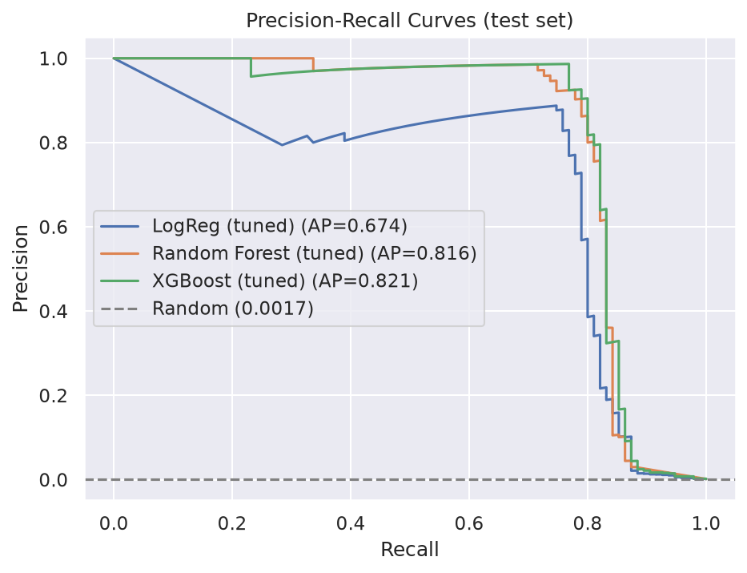
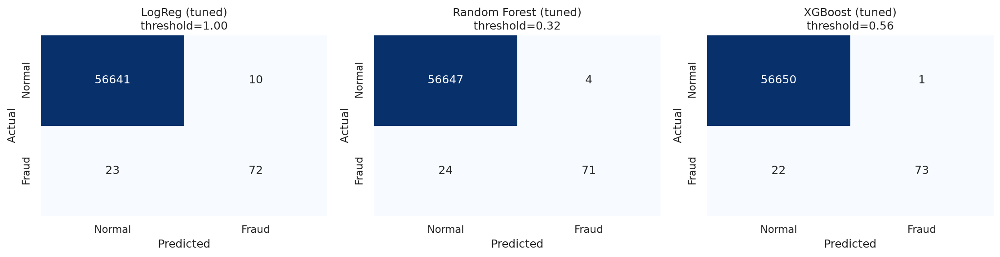

# Credit Card Fraud Detection

End-to-end machine learning project for detecting fraudulent credit card transactions
on a highly imbalanced dataset (0.17% fraud). The focus is on honest evaluation:
leakage-free preprocessing, metrics suited to imbalanced data (PR-AUC), threshold
selection without touching the test set, and ablation experiments.

## Dataset
[Credit Card Fraud Detection](https://www.kaggle.com/datasets/mlg-ulb/creditcardfraud) (Kaggle, ULB Machine Learning Group):
284,807 transactions over two days, 492 frauds. Features `V1`-`V28` are anonymized PCA
components; `Time` and `Amount` are raw. The CSV is not included in this repo (see the Kaggle page for the license).

After removing 1,081 duplicate rows: 283,726 transactions, 473 frauds (0.167%).

## Approach
1. **Cleaning:** removed duplicates before splitting (avoids train/test overlap).
2. **EDA:** class imbalance, amount distribution, hour-of-day pattern, feature-target correlation.
3. **Feature engineering:** `Amount_log`, cyclic hour encoding (`Hour_sin`, `Hour_cos`).
4. **Split & scaling:** stratified 80/20 split; `StandardScaler` fitted on train only.
5. **Modeling:** Logistic Regression (class weights / SMOTE), Random Forest, XGBoost,
   compared with stratified 5-fold CV on the training set (SMOTE inside the pipeline to avoid leakage).
6. **Tuning:** `RandomizedSearchCV` optimizing PR-AUC.
7. **Evaluation:** threshold chosen from out-of-fold train predictions; the test set is used once for reporting.

## Results
Final model: **XGBoost (tuned)**, threshold 0.556.

| Model | CV PR-AUC | Test PR-AUC | Precision | Recall | F1 |
|---|---|---|---|---|---|
| Logistic Regression (tuned) | 0.756 | 0.674 | 0.878 | 0.758 | 0.814 |
| Random Forest (tuned) | 0.843 | 0.816 | 0.947 | 0.747 | 0.835 |
| **XGBoost (tuned)** | **0.851** | **0.821** | **0.986** | **0.768** | **0.864** |

Test set confusion matrix (XGBoost): 73 frauds caught, 22 missed, 1 false alarm out of 56,651 normal transactions.




### Operating points (XGBoost)
Thresholds chosen on out-of-fold train predictions to reach a target recall; numbers are on the test set.

| Target recall | TP | FN | FP | Precision | Recall |
|---|---|---|---|---|---|
| 0.80 | 72 | 23 | 1 | 0.986 | 0.758 |
| 0.85 | 79 | 16 | 54 | 0.594 | 0.832 |
| 0.90 | 83 | 12 | 902 | 0.084 | 0.874 |

Catching the last few frauds is expensive: going from ~76% to ~87% recall raises false alarms from 1 to 902.
Which operating point is right depends on the business cost of a missed fraud versus a reviewed alert.

## Key findings
- Tree-based models beat Logistic Regression by about 0.1 PR-AUC; XGBoost and Random Forest are statistically indistinguishable.
- SMOTE gave no improvement (CV PR-AUC 0.755 vs 0.756).
- For XGBoost, `scale_pos_weight=10` worked better than the "balanced" value of ~600.
- Hour-of-day features showed a pattern in EDA but gave no CV gain (0.851 with and without).
- Top XGBoost features: `V14`, `V17`, `V10`.

## Limitations
- The test set has only 95 frauds; recall has a 95% interval of roughly 0.67-0.84.
- Features are PCA-anonymized, so findings are not interpretable in business terms.
- Random stratified split over two days of data; a time-based split and drift monitoring would be needed in production.
- Thresholds depend on the business cost trade-off, not only on F1.

## Project structure
```
├── data/raw/                 # creditcard.csv (not tracked)
├── notebooks/creditcard_fraud.ipynb
├── models/                   # fraud_xgb.joblib, scaler.joblib
├── reports/figures/
├── requirements.txt
└── README.md
```

## How to reproduce
```bash
python -m venv .venv && source .venv/bin/activate
pip install -r requirements.txt
# download creditcard.csv from Kaggle into data/raw/
jupyter lab   # run notebooks/creditcard_fraud.ipynb
```

## Using the saved model
```python
import joblib, pandas as pd
art = joblib.load("models/fraud_xgb.joblib")
scaler = joblib.load("models/scaler.joblib")
# X must contain the engineered features (Hour_sin, Hour_cos, Amount_log, V1-V28)
X_scaled = pd.DataFrame(scaler.transform(X[art["features"]]), columns=art["features"])
is_fraud = art["model"].predict_proba(X_scaled)[:, 1] >= art["threshold"]
```


## Thank You for rewied

### *Thank you for taking the time to explore this project*

*I hope this project has been useful and informative. Your feedback and suggestions are always appreciated.*

## Code • Learn • Build</h2>
